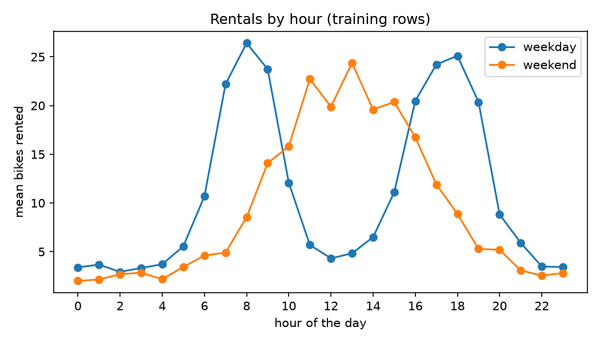
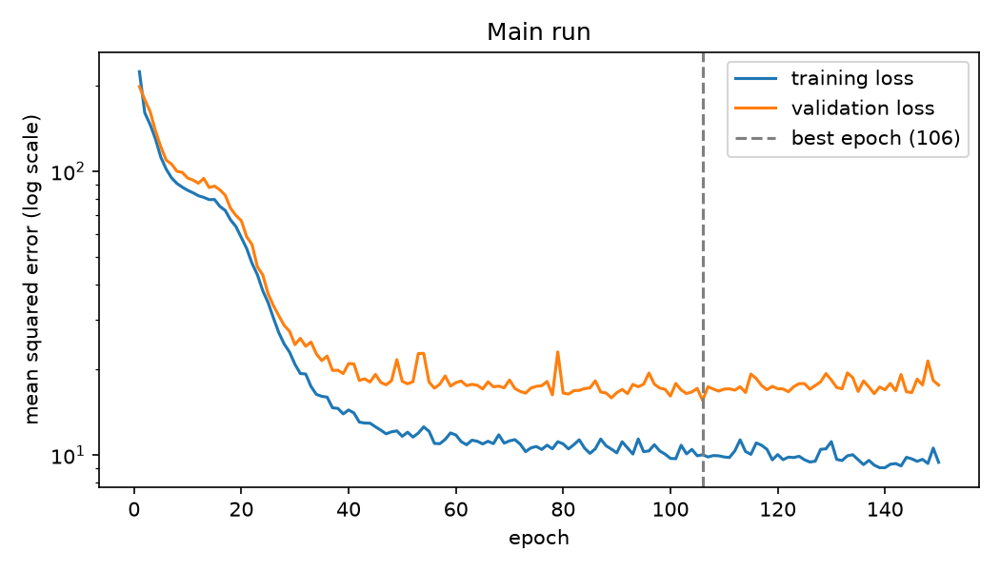

# Lakeshore Bike Demand

## What it does

This project predicts how many bikes will be rented at a Lakeshore Bike Share
station in a given hour, from the hour, the weather, the day type and the station
type. The network and its training loop are written by hand in PyTorch, compared
with two simple baselines, and tested with pytest.

## How to run it

```
conda env create -f environment.yml
conda activate lab07-first-principles
python train.py
python -m pytest
python -m ruff check .
python -m ruff format --check .
```

`python train.py` recreates everything in `reports/`: the plots, `history.csv`,
`experiments.csv` and `metrics.json`. It takes a few minutes on a laptop CPU.

## Data and split

The data come from `bikes_data.py`, given with the lab and committed unchanged in
its own commit. It makes 6,000 hourly rows with the columns hour,
temperature_c, rain_mm, wind_kph, is_weekend, station_type and the target,
rentals. Because the file must stay unchanged, it is excluded from ruff in
`pyproject.toml`.

The rows are split **before** any preparation, with seed 42: 60% training
(3,600 rows), 20% validation (1,200) and 20% test (1,200). The StandardScaler for
the five numeric columns and the OneHotEncoder for station_type are fitted on the
training rows only, then applied to all three splits. This keeps any information
from the validation and test rows out of the preparation. The tests check it:
the training features average exactly zero and the validation features do not.

## Model and training

- **Network:** `BikeNet`, an `nn.Module` with two hidden layers of 64 units and
  ReLU, ending in one output with no activation, because the target is a count
  and not a probability. The output is squeezed to shape (N,) to match the
  targets. 4,801 parameters.
- **Loss and optimizer:** mean squared error (`nn.MSELoss`) and Adam with a
  learning rate of 0.003.
- **Batches:** a custom `RentalsDataset` returns one row as float32 tensors.
  The training DataLoader uses batches of 64 and shuffles; the validation and
  test loaders do not shuffle.
- **Loop:** `run_epoch` trains when given an optimizer and only measures
  otherwise. `fit` trains for 150 epochs, logs the training loss, the validation
  loss and the MAE for every epoch, and puts back the weights of the epoch with
  the lowest validation loss.
- **Seeds:** `torch.manual_seed(42)` before each run and a seeded
  `torch.Generator` for the training DataLoader, so two runs on the same computer
  give identical numbers. On another computer the last digits may differ.
- Before trusting the loop, the network was trained on 16 rows for 300 steps and
  the loss fell to almost zero. This check is kept as a test.

## Results

Mean absolute error, in rentals per hour:

| Model | Validation MAE | Test MAE |
|---|---|---|
| Predict the training mean | 10.154 | 9.649 |
| Linear regression | 9.317 | 8.573 |
| **Network (main run)** | **2.616** | **2.461** |

The network is about 3.5 times more accurate than the linear model. The linear
model does poorly because rentals do not change with the hour in a straight line:
on weekdays there are two commuter peaks, around 8:00 and 17:00 to 18:00, and on
weekends there is a single midday peak (`reports/rentals_by_hour.png`). A
straight line in the hour cannot rise and fall twice, and it cannot change its
shape between weekdays and weekends. The ReLU layers of the network can.





In the main run both losses fall quickly for the first 30 epochs and then flatten
close together. The validation loss stays a little above the training loss and
does not turn upward, so the network learned what the data allow without
overfitting much. The best epoch was 106. The test set was used once, at the end,
after the network was chosen on the validation rows.

## Experiments

Each run changes one setting from the main run.

| Run | Changed | Best epoch | Best val MAE | Final train loss | Final val loss |
|---|---|---|---|---|---|
| main | – | 106 | 2.616 | 9.434 | 17.642 |
| lr_too_small | lr = 1e-5 | 150 | 9.252 | 194.381 | 226.670 |
| lr_too_large | lr = 0.1 | 44 | 2.959 | 17.316 | 24.037 |
| much_wider_deeper | hidden = 512, layers = 4 | 44 | 2.639 | 5.192 | 22.727 |

The curves for each run are in `reports/curves_<run>.png`.

- **lr_too_small: underfitting.** Both curves are still falling slowly at epoch
  150 and never flatten. The best epoch is the last one, which shows that
  training was not finished. The MAE of 9.25 is no better than the linear model.
- **lr_too_large: unstable.** The loss drops fast, then jumps up and down from
  epoch to epoch instead of settling. The steps are too big to land at the
  bottom, so both final losses are higher than in the main run.
- **much_wider_deeper: overfitting.** With about 800,000 parameters for 3,600
  rows, the training loss keeps falling to 5.2 while the validation loss turns
  upward after epoch 44. The gap between the two curves keeps growing: the
  network is memorising the training rows. Restoring the best weights saves its
  MAE, but it is no better than the much smaller main network.

## Limitations

- The data are synthetic: 6,000 rows produced by `bikes_data.py`, not real trips
  from Lakeshore Bike Share. The model has learned the rules of that generator,
  and its accuracy on real stations is unknown.
- The model sees only the hour, temperature, rain, wind, weekday or weekend and
  three station types. It cannot see holidays, events, the season, school terms,
  a station's exact location or how many docks it has, so it will be wrong on
  days that are unusual for those reasons.
- An MAE of about 2.5 is an average. The error is larger at the busy commuter
  peaks, where a planner most needs the right number.
- It gives one number with no range of uncertainty, and it shows patterns, not
  causes.
- A planner should not use it to decide how many bikes a specific real station
  needs, or for long-term decisions, without first testing it on real data.